<!-- 👋 Hi there! Welcome to my GitHub profile -->

<!-- cards:start -->

<!-- cards:end -->

<h1 align="center">Hi, I'm Navtesh 👋</h1>
<h3 align="center">🚀 Web Developer | 💻 Python Learner | 🌱 AI Explorer</h3>

---

### 🧠 About Me
- 🌍 From Devgad, Sindhudurg  
- 🔭 Currently learning **Python**, **React**, and **Tailwind CSS**  
- 🌱 Exploring **AI**, **Machine Learning**, and **Web Development**  
- 🎯 Goal: To build creative and impactful digital experiences  
- ⚡ Fun fact: I love coding, football, and singing 🎶  

---

### 🛠️ Tech Stack

  

---

### 💼 Featured Projects
Here are some of my favorite projects 👇

| Project | Description | Tech Used |
|----------|--------------|-----------|
| [**React Jobs App**](https://github.com/Navtesh00/react-jobs-app) | A modern job listing app built with React & Tailwind. | React, TailwindCSS |
| [**Proposal**](https://github.com/Navtesh00/proposal) | A Python-based project for learning and experimenting. | Python |
| **Sudiksha Desire (Restaurant Website)** | A creative and nature-themed restaurant website. | HTML, CSS, JS, Tailwind |

---

### 📊 GitHub Stats

  

---

### 🌐 Connect With Me

[]

---

### ✨ "Code. Create. Learn. Repeat." ✨
> _Thanks for visiting my profile!_  
> _⭐ Don’t forget to star a repo if you like my work._
