# Navtesh Gophane

**Frontend-focused developer building thoughtful web products with React, TypeScript and Node.js.**

<!-- cards:start -->
       
<!-- cards:end -->

---

## About

I'm a developer from Sindhudurg, Maharashtra, interested in building useful products and understanding the engineering behind them — from polished interfaces to reliable APIs.

I enjoy working across the stack, learning fundamentals deeply, and turning ideas into practical software.

## Current focus

- Strengthening backend engineering: databases, authentication, caching and system design.
- Building product-style applications with React, TypeScript, Node.js and Express.
- Exploring motion and interactive interfaces with GSAP and Three.js.

## Toolkit

**Frontend:** HTML, CSS, JavaScript, React, TypeScript, Tailwind CSS, GSAP

**Backend:** Node.js, Express, REST APIs

**Exploring:** MongoDB, Redis, PostgreSQL, authentication, caching and Three.js

## Connect

- [GitHub](https://github.com/Navtesh00)
- [LinkedIn](https://www.linkedin.com/in/navtesh-gophane/)
- [AgentCart live demo](https://agentcart-orpin.vercel.app)

---

Code. Create. Learn. Repeat.
